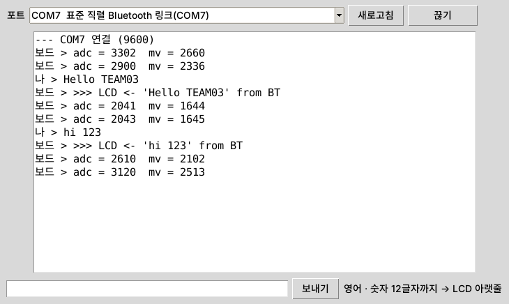

# stm32-bt — 블루투스로 보드와 값 주고받기

인천 전자 마이스터고 펌웨어 자율 전공 동아리 — 마지막 시간 실습 파일.

| 파일 | 무엇 |
|---|---|
| `stm32/main.c` | 보드 코드 (NUCLEO-F103RB) — CubeMX 로 만든 프로젝트의 `Core/Src/main.c` 를 이 내용으로 통째로 바꾼다 |
| `bt_talk.py` | 노트북 프로그램 — 보드가 보낸 값을 보고, 글자를 보내 LCD 에 띄운다 |
| `serial/` | 시리얼 도구 (pyserial 3.5, BSD 라이선스) — `bt_talk.py` 옆에 그대로 둔다 |

## 1. 받기
주소 : https://github.com/mongshell10/stm32-bt  
초록색 **Code** 버튼 › **Download ZIP** → 받은 ZIP 오른쪽 클릭 › **압축 풀기**

## 2. 보드 (STM32)
1. CubeMX 설정 (수업 자료대로) → Generate Code
2. `stm32/main.c` 를 **메모장**으로 열기 → Ctrl+A, Ctrl+C
3. CubeIDE 의 `Core/Src/main.c` 열기 → Ctrl+A, Ctrl+V → 저장
4. 맨 위 `#define TEAM_NAME "TEAM03"` 을 우리 조 이름으로 → 실행 (Run)

## 3. 노트북 (파이썬)
1. https://www.python.org › Downloads › Windows › **Windows installer (64-bit)** 설치
   - "Use admin privileges …" **체크 해제**, "Add python.exe to PATH" **체크** → Install Now
2. 노트북 블루투스에서 우리 조 이름(TEAM03 …)과 짝 맺기 (PIN 1234)
3. `bt_talk.py` **더블클릭** (안 열리면 IDLE › File › Open › F5)
4. 포트에서 '표준 직렬 Bluetooth 링크' 를 고르고 **연결** → 글자 치고 Enter → LCD 아랫줄에

> pip · 명령 프롬프트 · .bat 은 쓰지 않습니다.
